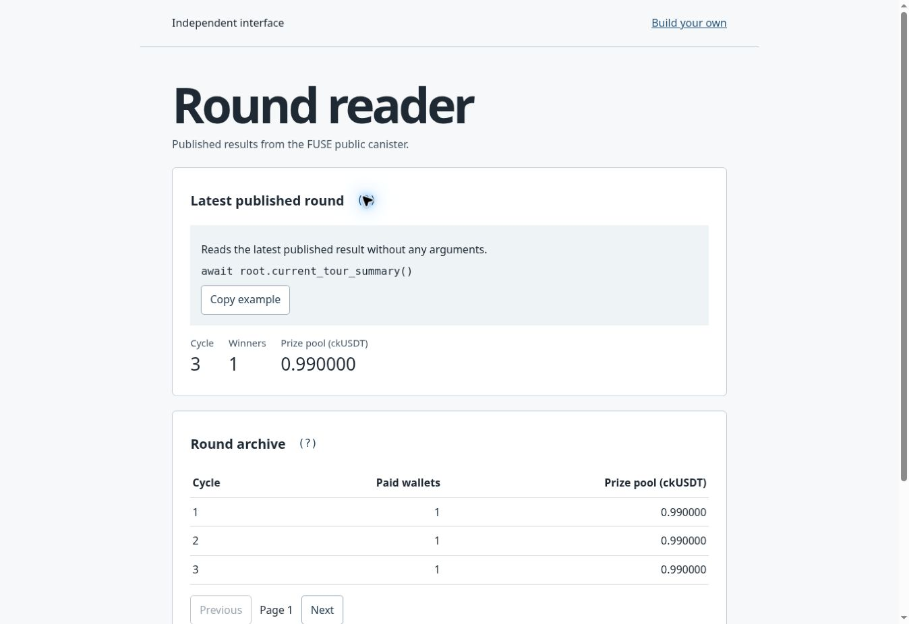

# FUSE Interface Kit

Build an independent website that connects to FUSE on the Internet Computer. You build the interface; FUSE records participation, calculates rounds, and tracks payouts.

[Official FUSE website](https://fuseprotocol.org/) · [Developer Docs](https://fuse-foundation.gitbook.io/fuse-foundation-docs/) · [Live Round Reader](https://public-round-reader.sergeysolomatin.chatgpt.site/)

## Try the browser demo

[**Open Round Reader**](https://public-round-reader.sergeysolomatin.chatgpt.site/) to see the latest published round and browse the archive. This independent example uses only public FUSE queries. It does not require a wallet, registration, or payments. The `(?)` disclosures show the exact calls behind the interface.

[](https://public-round-reader.sergeysolomatin.chatgpt.site/)

[Browse the example source and setup steps](examples/round-reader/README.md).

## Start building

1. Start with the [FUSE Interface Guide](https://fuse-foundation.gitbook.io/fuse-foundation-docs/). You can read public round results without a wallet, registration, or bond: see [Read rounds without registering](#read-rounds-without-registering).
2. Follow [Register and activate your website](docs/QUICKSTART.md). After activation, save the assigned `interface_id` and deposit `memo`.
3. Read the [API reference](docs/API.md), validate your configuration, and test the integration before enabling participant payments.

| Resource | File |
| --- | --- |
| Registration, domain verification, bond, and earnings | [Operator quick start](docs/QUICKSTART.md) |
| Methods, permissions, amounts, pagination, and error handling | [API reference](docs/API.md) |
| Root canister contract and JavaScript bindings | [Candid](api/fuse-interface.did) · [JavaScript](api/fuse-interface.idl.mjs) |
| Read published rounds and the current forecast as a guest | [Guest round example](examples/read-rounds.mjs) |
| Read details for an already registered interface | [Read-only example](examples/read-interface.mjs) |
| Prepare, sign, and check an existing deposit | [OISY example](examples/oisy-deposit.mjs) |
| Test scenarios before launch | [Launch checklist](docs/LAUNCH-CHECKLIST.md) |
| Guidance for Codex | [FUSE Interface skill](skills/fuse-interface/SKILL.md) |

## Read rounds without registering

Use Node.js 22 or later:

```bash
git clone https://github.com/fusefoundation/fuse-interface-kit.git
cd fuse-interface-kit
npm ci
npm test
npm run rounds
```

`npm run rounds` reads the latest published round and any available forecast from mainnet. It does not connect a wallet, register a site, or move funds. For a specific published round, append its decimal cycle ID: `npm run rounds -- <cycle_id>` (replace the placeholder).

## Check an already registered interface

`npm run read -- "$FUSE_INTERFACE_ID"` checks the active registration, deposit memo, ledger fee, and data freshness. Set the variable to the exact decimal ID shown in the interface dashboard. This read-only check requires an active interface ID, but no credentials.

The tests use fixtures locally. Test the browser wallet flow in an agreed test environment before exposing money operations. For help with registration, email [partners@fuseprotocol.org](mailto:partners@fuseprotocol.org).

## Install the Codex skill

From the root of your project, in Bash:

```bash
FUSE_KIT_DIR=$(mktemp -d)
git clone --depth 1 https://github.com/fusefoundation/fuse-interface-kit.git "$FUSE_KIT_DIR"
mkdir -p .agents/skills
cp -R "$FUSE_KIT_DIR/skills/fuse-interface" .agents/skills/
rm -rf -- "$FUSE_KIT_DIR"
```

Open a new Codex session and invoke `$fuse-interface`. Give it the domain, the interface ID if assigned, and the task. Public configuration is enough for read-only work. Do not share keys or wallet credentials.

## Security

See the [security policy](SECURITY.md) for private reporting.
